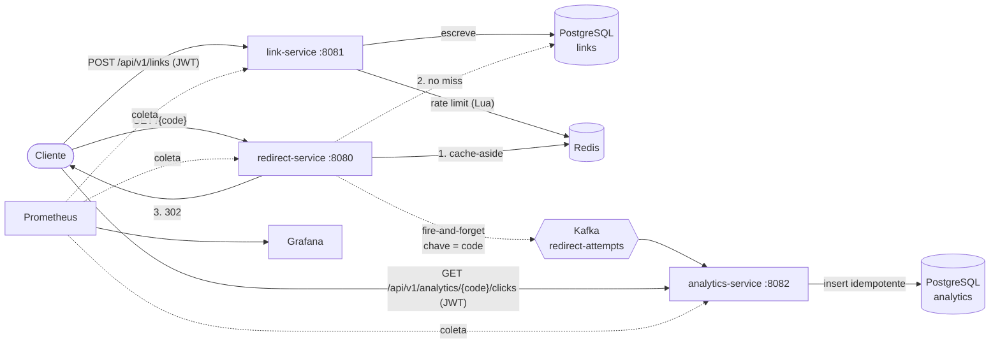

# LinkPulse

[🇺🇸 English](README.md)

Um encurtador de URLs com análise de cliques em tempo real, construído como 3 serviços Spring Boot independentes conectados por Redis e Kafka. Foi desenhado para responder a uma pergunta que um CRUD simples nunca obriga a responder: **como manter um redirect rápido (e mensurável) quando todo clique também precisa ser registrado, sem que a análise jamais deixe o redirect mais lento?** Construído como projeto de portfólio para vagas de estágio/júnior em backend Java.

Um usuário cria um link curto, qualquer pessoa pode acessá-lo, e o dono consulta quantos cliques ele recebeu por hora ou por dia — com cada camada (cache, pipeline assíncrono, rate limit, CI/CD, observabilidade) medida em vez de presumida.

## Por que esse projeto

Meus projetos anteriores ([order-processing-system](https://github.com/Rangeldev73/order-processing-system) e [eduflow-cloud](https://github.com/Rangeldev73/eduflow-cloud)) focaram em comunicação entre serviços e padrões de resiliência. O LinkPulse fecha outra lacuna: **engenharia de performance**. O caminho do redirect é um hot path de leitura, então o projeto é construído em torno de medi-lo (k6), melhorá-lo (Redis cache-aside), desacoplar um efeito colateral dele (Kafka, fire-and-forget), proteger o caminho de escrita (rate limit distribuído) e ser honesto sobre o que cada passo custou e o que ele *não* provou.

## Funcionalidades

- **3 serviços com responsabilidades separadas** — `link-service` (cria e gerencia links, escrita), `redirect-service` (o hot path de leitura), `analytics-service` (consome eventos de clique e responde consultas de estatística).
- **Redis cache-aside no caminho do redirect** — um DTO `CachedLink` com TTL de 3 minutos, mais um *sentinela de cache negativo* para que códigos inexistentes não martelem o banco. Um teste de stampede dedicado (k6) acessa chaves frias de forma concorrente.
- **Pipeline assíncrono de cliques via Kafka** — o `redirect-service` publica um `RedirectAttemptEvent` com chave = código curto; o `analytics-service` consome. O produtor é fire-and-forget com `max.block.ms=100`, então uma queda do Kafka custa dados de analytics, nunca a disponibilidade do redirect.
- **Entrega at-least-once tratada com consumidor idempotente** — uma constraint `UNIQUE` em `event_id` transforma um evento reentregue numa operação segura e inofensiva; mensagens venenosas vão para um tópico dead-letter (`redirect-attempts-dlt`) via `ErrorHandlingDeserializer` + `DeadLetterPublishingRecoverer`.
- **API de estatísticas com escopo por dono** — `GET /api/v1/analytics/{code}/clicks?granularity=hour|day&from&to`. A autorização é aplicada *dentro do SQL* (`owner_id = jwt.sub`), e quem não é dono recebe `200` com buckets vazios em vez de `404`, impedindo enumeração de códigos.
- **Um índice composto provado com `EXPLAIN`** — `(code, occurred_at)` faz a query de estatísticas virar um Bitmap Index Scan (~10 ms em 200 mil linhas).
- **Rate limit distribuído** — contador de janela fixa no Redis via script Lua atômico (`INCR` + `EXPIRE`), por usuário autenticado, retornando `429` com `Retry-After`. Ele deliberadamente **falha aberto** se o Redis cair.
- **Segurança JWT stateless (HS256)** no `link-service` e no `analytics-service`, com contrato de erro `ProblemDetail` consistente.
- **Observabilidade** — Micrometer + Prometheus + Grafana com dashboard provisionado: redirects por resultado, latência p95, rejeições do rate limit, throughput do analytics, heap da JVM.
- **Testes de integração reais** — Testcontainers (PostgreSQL, Redis, Kafka) com containers singleton compartilhados entre as classes de teste, incluindo um teste end-to-end com Kafka.
- **CI/CD** — o GitHub Actions roda toda a suíte de testes e constrói uma imagem Docker por serviço, publicada no GHCR a partir da `main`.

## Stack tecnológica

| Camada | Tecnologia |
|---|---|
| Linguagem / Runtime | Java 25 |
| Framework | Spring Boot 4.1 (Spring MVC, Spring Security resource server, Spring Data JPA) |
| Build | Maven multi-module |
| Persistência | PostgreSQL 16 (um banco para links, outro separado para analytics), migrations Flyway |
| Cache / Rate limit | Redis 7 (script Lua para contadores atômicos) |
| Mensageria | Apache Kafka (KRaft, nó único), serialização JSON, DLT |
| Observabilidade | Micrometer, Prometheus, Grafana |
| Teste de carga | k6 |
| Testes | JUnit 5, AssertJ, Mockito, Testcontainers |
| CI/CD | GitHub Actions, Dockerfile multi-stage, GHCR |

## Arquitetura

### Serviços

| Serviço | Papel | Endpoints principais | Armazenamento | Porta |
|---|---|---|---|---|
| `link-service` | Cria links, dono do banco de links, limita a criação | `POST /api/v1/links`, `GET /api/v1/links/{code}` (JWT) | PostgreSQL `linkpulse`, Redis | 8081 |
| `redirect-service` | Hot path de leitura: resolve um código e responde `302`, publica um evento de clique | `GET /{code}` (público) | Cache Redis, lê o banco de links, produtor Kafka | 8080 |
| `analytics-service` | Consome eventos de clique, armazena, serve estatísticas | `GET /api/v1/analytics/{code}/clicks` (JWT) | PostgreSQL `analytics`, consumidor Kafka | 8082 |

### Infraestrutura (Docker Compose)

| Componente | Papel | Porta |
|---|---|---|
| PostgreSQL (links) | Dados dos links | `POSTGRES_PORT` |
| PostgreSQL (analytics) | Eventos de clique | `ANALYTICS_DB_PORT` |
| Redis | Cache do redirect + contadores do rate limit | `REDIS_PORT` |
| Kafka (KRaft) | Tópico `redirect-attempts` + DLT | `KAFKA_PORT` |
| Prometheus | Coleta o `/actuator/prometheus` dos 3 serviços | 9090 |
| Grafana | Dashboard "LinkPulse Overview" (provisionado) | 3000 |

### Fluxo de requisições



O dono do link viaja junto com o clique: `tb_links.user_id` → `CachedLink` → `RedirectAttemptEvent.ownerId` → `tb_click_events.owner_id`. É isso que permite ao `analytics-service` autorizar uma consulta de estatística sem nunca chamar o `link-service`.

### Camadas (por serviço)

```
domain/          → entidades e exceções de negócio
application/     → serviços, DTOs, portas (ex.: RateLimiter)
infrastructure/  → web (controllers, interceptors, exception handlers), persistência, mensageria, segurança, config
```

## Resultados de performance (k6, máquina local)

| Etapa | Req/s | Mediana | p95 | O que mudou |
|---|---|---|---|---|
| Baseline | ~641 | 61,5 ms | 165,2 ms | Todo redirect consulta o PostgreSQL |
| Redis cache-aside | ~4.176 | 10,4 ms | 19,9 ms | Chaves quentes servidas pelo Redis |
| Teste de cache stampede | ~3.118 | 13,4 ms | 28,4 ms | Chaves frias acessadas de forma concorrente |
| Redis + produtor Kafka | ~2.705 | 15,7 ms | 29,4 ms | Todo redirect também publica um evento de clique |

Os resumos brutos do k6 estão em [`load-tests/results/`](load-tests/results). Com o produtor Kafka ligado, **0 eventos foram perdidos** (o delta de offsets bateu exatamente com o número de requisições).

Como ler esses números com honestidade:

- A etapa com Kafka é mais lenta que a só com Redis, mas broker, serviços, PostgreSQL, Redis e k6 dividem a mesma máquina, então o overhead do produtor **não foi isolado** (não houve execução de controle).
- Usar o código curto como chave dá ordenação por código, mas produz **partições desbalanceadas** sob chaves quentes — esperado numa carga tipo Zipf.
- A latência "antes do índice" da query de estatísticas **não foi medida**; só o plano "depois" foi verificado com `EXPLAIN`.

## Decisões de design que vale a pena ler

- **O analytics nunca pode quebrar um redirect.** O produtor Kafka é fire-and-forget com `max.block.ms=100`: com o broker fora, o `send()` desiste em 100 ms em vez de travar a thread da requisição pelos 60 s padrão. Falhas são logadas com o payload completo (nossa trilha de auditoria) e engolidas.
- **At-least-once + consumidor idempotente, não "exactly once".** Um `event_id` duplicado bate na constraint `UNIQUE` (`uk_click_events_event_id`) e é ignorado; qualquer *outra* violação de integridade é relançada para chegar na DLT em vez de ser escondida.
- **A autorização mora na query.** `WHERE code = :code AND owner_id = :ownerId` significa que um bug num controller não consegue vazar dados de outro usuário. Quem não é dono recebe buckets vazios (`200`), nunca `404`, para evitar enumeração de códigos.
- **Os buckets de tempo são semiabertos e em UTC.** A janela é `[start, end)`, só tentativas `SUCCESS` contam, e a janela máxima é 7 dias para granularidade por hora e 366 dias por dia, então uma única query não varre a tabela inteira.
- **Rate limit: janela fixa, fail-open.** Janela fixa usa memória O(1) e uma única chamada Lua atômica; o trade-off conhecido é até 2× o limite na virada da janela (uma janela deslizante resolveria, a um custo maior). Se o Redis estiver indisponível, a criação de links continua disponível — uma escolha deliberada de disponibilidade sobre rigidez.
- **As tags das métricas têm baixa cardinalidade de propósito.** `linkpulse.redirects{outcome=…}` usa um conjunto fechado (`success`, `not_found`, `inactive`, `expired`, `invalid_url`). O código curto nunca é tag: ele é ilimitado e explodiria o número de séries temporais.
- **Testcontainers singleton.** O Spring faz cache dos contextos entre classes de teste, então um container por classe ganha uma porta nova enquanto o contexto em cache ainda aponta pra antiga. Os containers sobem uma vez num bloco estático e vivem durante toda a JVM.
- **CRLF vs LF.** Desenvolver no Windows gerou arquivos "modificados" fantasmas e um script shell com `\r` que quebrava em containers Linux; o `.gitattributes` normaliza as quebras de linha e o Dockerfile remove `\r` do `mvnw` por segurança.

## Como rodar localmente

Requisitos: Java 25, Docker (Compose v2).

```bash
git clone https://github.com/Rangeldev73/linkpulse.git
cd linkpulse
cp .env.example .env
# edite o .env: defina as senhas e gere o segredo JWT (veja abaixo)
docker compose up -d        # PostgreSQL x2, Redis, Kafka, Prometheus, Grafana
```

Gere um segredo de 32 bytes em Base64 e use o **mesmo valor** em `LINK_SERVICE_JWT_SECRET_BASE64` e `ANALYTICS_SERVICE_JWT_SECRET_BASE64`:

```bash
openssl rand -base64 32
```

Depois suba cada serviço com o profile `local` e as variáveis do `.env` exportadas (ou configuradas na run configuration da sua IDE):

```bash
SPRING_PROFILES_ACTIVE=local ./mvnw -pl link-service spring-boot:run
SPRING_PROFILES_ACTIVE=local ./mvnw -pl redirect-service spring-boot:run
SPRING_PROFILES_ACTIVE=local ./mvnw -pl analytics-service spring-boot:run
```

| O quê | URL |
|---|---|
| link-service | http://localhost:8081 |
| redirect-service | http://localhost:8080 |
| analytics-service | http://localhost:8082 |
| Prometheus | http://localhost:9090 |
| Grafana (`admin` / `GRAFANA_ADMIN_PASSWORD`, padrão `admin`) | http://localhost:3000 |

> Os serviços rodam no host, não no Docker, então o Prometheus os acessa via `host.docker.internal`. As imagens Docker de cada serviço são construídas pelo CI (veja abaixo), mas ainda não fazem parte do arquivo Compose.

### Testando

Não existe endpoint de login de propósito (identidade está fora do escopo); os serviços só *validam* tokens. Crie um token de desenvolvimento assinado com o seu segredo:

```bash
export TOKEN=$(python3 - <<'PY'
import base64, hashlib, hmac, json, os, time
secret = base64.b64decode(os.environ["LINK_SERVICE_JWT_SECRET_BASE64"])
b64 = lambda b: base64.urlsafe_b64encode(b).rstrip(b"=")
head = b64(json.dumps({"alg": "HS256", "typ": "JWT"}).encode())
body = b64(json.dumps({"sub": "demo-user", "exp": int(time.time()) + 3600}).encode())
sig = b64(hmac.new(secret, head + b"." + body, hashlib.sha256).digest())
print((head + b"." + body + b"." + sig).decode())
PY
)

# 1. Cria um link curto
curl -s -X POST http://localhost:8081/api/v1/links \
  -H "Authorization: Bearer $TOKEN" -H "Content-Type: application/json" \
  -d '{"originalUrl":"https://example.com","customAlias":"demo"}'

# 2. Acessa duas vezes (público, sem token)
curl -i http://localhost:8080/demo
curl -i http://localhost:8080/demo

# 3. Consulta as estatísticas por hora (alguns segundos depois, quando o evento for consumido)
curl -s -H "Authorization: Bearer $TOKEN" \
  "http://localhost:8082/api/v1/analytics/demo/clicks?granularity=hour"
```

Crie mais de 10 links em um minuto para ver `429 Too Many Requests` com o header `Retry-After`. Abra o Grafana para ver o dashboard reagindo.

### Testes de carga

```bash
docker run --rm -i --network host -v "$PWD/load-tests:/work" grafana/k6 run /work/k6/redirect-redis-test.js
```

Os dados de seed estão em `load-tests/seed/seed-links.sql` (50 links quentes + 950 frios).

## Testes

```bash
./mvnw test
```

Requer Docker (o Testcontainers sobe PostgreSQL, Redis e Kafka). A suíte cobre queries de repositório (incluindo isolamento por dono), lógica de serviço com `Clock` fixo, segurança JWT (token ausente, expirado e com assinatura inválida), o rate limiter Redis (incluindo fail-open) e um fluxo end-to-end com Kafka com idempotência e payload legado. No CI, `-Dsurefire.rerunFailingTestsCount=1` absorve uma instabilidade de infraestrutura conhecida ("Text file busy" ao subir o container do Kafka).

## CI/CD

O `.github/workflows/ci.yml` tem dois jobs: **test** (build Maven completo com Testcontainers) e **images** (constrói uma imagem por serviço a partir de um único `Dockerfile` multi-stage parametrizado, publicando no GitHub Container Registry na `main`). Não há etapa de deploy — o escopo do projeto termina em artefatos containerizados, testados automaticamente e executados localmente.

## Limitações conhecidas / pendências

- **Segredo HS256 compartilhado.** `link-service` e `analytics-service` dividem a chave de assinatura, então um analytics comprometido poderia forjar tokens. Em produção, o correto é assinatura assimétrica (RS256 + JWKS) com um provedor de identidade dedicado.
- **Débito de banco compartilhado.** O `redirect-service` lê o banco de links diretamente (caminho mais rápido, código mais simples) em vez de chamar o `link-service` ou consumir eventos de link; isso acopla os dois schemas.
- **Sem pré-agregação.** As estatísticas são calculadas a partir dos eventos brutos. Os heap fetches dominam a query; tabelas de rollup por hora/dia são o próximo passo documentado.
- **O rate limit de janela fixa** permite um burst de 2× na virada da janela.
- **Kafka de nó único** (replication factor 1) — ok para ambiente local, não para produção.
- **Quebras por dispositivo/referrer** são coletadas nos eventos, mas não agregadas pela API de estatísticas.
- **`/actuator/prometheus` não tem autenticação** por conveniência; em produção ele pertence a uma porta ou rede de gerenciamento separada.
- **Os serviços ainda não estão no Compose**, e nada é implantado em nuvem.
