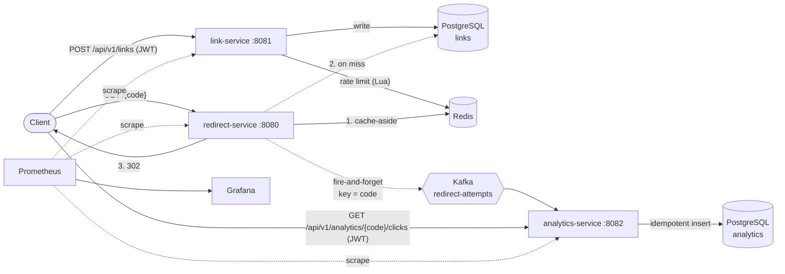

# LinkPulse

[🇧🇷 Português](README.PT-BR.md)

A URL shortener with real-time click analytics, built as 3 independent Spring Boot services connected by Redis and Kafka. It was designed to answer one question that a simple CRUD project never forces you to answer: **how do you keep a redirect fast (and measurable) when every click must also be recorded, without the analytics ever slowing the redirect down?** Built as a portfolio project for Java backend internship/junior roles.

A user creates a short link, anyone can follow it, and the owner can query how many clicks it received per hour or per day — with every layer (cache, async pipeline, rate limiting, CI/CD, observability) measured rather than assumed.

## Why this project

My previous projects ([order-processing-system](https://github.com/Rangeldev73/order-processing-system) and [eduflow-cloud](https://github.com/Rangeldev73/eduflow-cloud)) focused on service communication and resilience patterns. LinkPulse closes a different gap: **performance engineering**. The redirect path is a read-heavy hot path, so the project is built around measuring it (k6), improving it (Redis cache-aside), decoupling a side effect from it (Kafka, fire-and-forget), protecting the write path (distributed rate limit) and being honest about what each step cost and what it did *not* prove.

## Features

- **3 services with separated responsibilities** — `link-service` (creates and manages links, writes), `redirect-service` (the hot read path), `analytics-service` (consumes click events and answers statistics queries).
- **Redis cache-aside on the redirect path** — a `CachedLink` DTO with a 3-minute TTL, plus a *negative-cache sentinel* so unknown codes don't hammer the database. A dedicated stampede test (k6) hits cold keys concurrently.
- **Asynchronous click pipeline over Kafka** — `redirect-service` publishes a `RedirectAttemptEvent` keyed by short code; `analytics-service` consumes it. The producer is fire-and-forget with `max.block.ms=100`, so a Kafka outage costs analytics data, never redirect availability.
- **At-least-once delivery handled with an idempotent consumer** — a `UNIQUE` constraint on `event_id` turns a redelivered event into a safe no-op; poison messages go to a dead-letter topic (`redirect-attempts-dlt`) through `ErrorHandlingDeserializer` + `DeadLetterPublishingRecoverer`.
- **Owner-scoped statistics API** — `GET /api/v1/analytics/{code}/clicks?granularity=hour|day&from&to`. Authorization is enforced *inside the SQL* (`owner_id = jwt.sub`), and a non-owner receives `200` with empty buckets instead of `404`, so codes cannot be enumerated.
- **A composite index proven with `EXPLAIN`** — `(code, occurred_at)` turns the stats query into a Bitmap Index Scan (~10 ms on 200k rows).
- **Distributed rate limiting** — fixed-window counter in Redis through an atomic Lua script (`INCR` + `EXPIRE`), per authenticated user, returning `429` with `Retry-After`. It deliberately **fails open** if Redis is down.
- **Stateless JWT security (HS256)** on `link-service` and `analytics-service`, with a consistent `ProblemDetail` error contract.
- **Observability** — Micrometer + Prometheus + Grafana with a provisioned dashboard: redirects per outcome, p95 latency, rate-limit rejections, analytics throughput, JVM heap.
- **Real integration tests** — Testcontainers (PostgreSQL, Redis, Kafka) with singleton containers shared across test classes, including a Kafka end-to-end test.
- **CI/CD** — GitHub Actions runs the whole test suite and builds one Docker image per service, pushed to GHCR from `main`.

## Tech stack

| Layer | Technology |
|---|---|
| Language / Runtime | Java 25 |
| Framework | Spring Boot 4.1 (Spring MVC, Spring Security resource server, Spring Data JPA) |
| Build | Maven multi-module |
| Persistence | PostgreSQL 16 (one database for links, a separate one for analytics), Flyway migrations |
| Cache / Rate limit | Redis 7 (Lua script for atomic counters) |
| Messaging | Apache Kafka (KRaft, single node), JSON serialization, DLT |
| Observability | Micrometer, Prometheus, Grafana |
| Load testing | k6 |
| Testing | JUnit 5, AssertJ, Mockito, Testcontainers |
| CI/CD | GitHub Actions, multi-stage Dockerfile, GHCR |

## Architecture

### Services

| Service | Role | Main endpoints | Storage | Port |
|---|---|---|---|---|
| `link-service` | Creates links, owns the link database, rate-limits creation | `POST /api/v1/links`, `GET /api/v1/links/{code}` (JWT) | PostgreSQL `linkpulse`, Redis | 8081 |
| `redirect-service` | Hot read path: resolves a code and answers `302`, publishes a click event | `GET /{code}` (public) | Redis cache, reads the link database, Kafka producer | 8080 |
| `analytics-service` | Consumes click events, stores them, serves statistics | `GET /api/v1/analytics/{code}/clicks` (JWT) | PostgreSQL `analytics`, Kafka consumer | 8082 |

### Infrastructure (Docker Compose)

| Component | Role | Port |
|---|---|---|
| PostgreSQL (links) | Link data | `POSTGRES_PORT` |
| PostgreSQL (analytics) | Click events | `ANALYTICS_DB_PORT` |
| Redis | Redirect cache + rate-limit counters | `REDIS_PORT` |
| Kafka (KRaft) | `redirect-attempts` topic + DLT | `KAFKA_PORT` |
| Prometheus | Scrapes `/actuator/prometheus` of the 3 services | 9090 |
| Grafana | Dashboard "LinkPulse Overview" (provisioned) | 3000 |

### Request flow



The owner of a link travels with the click: `tb_links.user_id` → `CachedLink` → `RedirectAttemptEvent.ownerId` → `tb_click_events.owner_id`. That is what lets `analytics-service` authorize a statistics query without ever calling `link-service`.

### Layers (per service)

```
domain/          → entities and business exceptions
application/     → services, DTOs, ports (e.g. RateLimiter)
infrastructure/  → web (controllers, interceptors, exception handlers), persistence, messaging, security, config
```

## Performance results (k6, local machine)

| Step | Requests/s | Median | p95 | What changed |
|---|---|---|---|---|
| Baseline | ~641 | 61.5 ms | 165.2 ms | Every redirect hits PostgreSQL |
| Redis cache-aside | ~4,176 | 10.4 ms | 19.9 ms | Hot keys served from Redis |
| Cache stampede test | ~3,118 | 13.4 ms | 28.4 ms | Cold keys requested concurrently |
| Redis + Kafka producer | ~2,705 | 15.7 ms | 29.4 ms | Every redirect also publishes a click event |

Raw k6 summaries are in [`load-tests/results/`](load-tests/results). With the Kafka producer enabled, **0 events were lost** (offset delta matched the request count exactly).

How to read these numbers honestly:

- The Kafka step is slower than the Redis-only step, but the broker, the services, PostgreSQL, Redis and k6 all share one machine, so the producer's own overhead was **not isolated** (no control run).
- Keying events by short code gives per-code ordering but produces **skewed partitions** under hot keys — expected with a Zipf-like load.
- The "before index" latency of the stats query was **not measured**; only the "after" plan was verified with `EXPLAIN`.

## Design decisions worth reading

- **Analytics must never break a redirect.** The Kafka producer is fire-and-forget and `max.block.ms=100`: with the broker down, `send()` gives up in 100 ms instead of stalling the request thread for the default 60 s. Failures are logged with the full payload (our audit trail) and swallowed.
- **At-least-once + idempotent consumer, not "exactly once".** A duplicate `event_id` hits the `UNIQUE` constraint (`uk_click_events_event_id`) and is skipped; any *other* integrity violation is rethrown so it reaches the DLT instead of being hidden.
- **Authorization lives in the query.** `WHERE code = :code AND owner_id = :ownerId` means a bug in a controller cannot leak another user's data. Non-owners get empty buckets (`200`), never `404`, to prevent code enumeration.
- **Time buckets are half-open and UTC.** The window is `[start, end)`, only `SUCCESS` attempts count, and the maximum window is 7 days for hourly and 366 days for daily granularity, so a single query can't scan the whole table.
- **Rate limit: fixed window, fail-open.** A fixed window is O(1) memory and one atomic Lua call; the known trade-off is up to 2× the limit around a window boundary (a sliding window would fix it at higher cost). If Redis is unavailable, link creation stays available — a deliberate availability-over-strictness choice.
- **Metric tags are low-cardinality on purpose.** `linkpulse.redirects{outcome=…}` uses a closed set (`success`, `not_found`, `inactive`, `expired`, `invalid_url`). The short code is never a tag: it's unbounded and would blow up the number of time series.
- **Singleton Testcontainers.** Spring caches application contexts across test classes, so a per-class container gets a new port while the cached context still points at the old one. Containers start once in a static block and live for the whole JVM.
- **CRLF vs LF.** Developing on Windows produced phantom "modified" files and a shell script with `\r` that broke inside Linux containers; `.gitattributes` normalizes line endings and the Dockerfile strips `\r` from `mvnw` defensively.

## How to run locally

Requirements: Java 25, Docker (Compose v2).

```bash
git clone https://github.com/Rangeldev73/linkpulse.git
cd linkpulse
cp .env.example .env
# edit .env: set passwords and generate the JWT secret (see below)
docker compose up -d        # PostgreSQL x2, Redis, Kafka, Prometheus, Grafana
```

Generate one 32-byte Base64 secret and use the **same value** for `LINK_SERVICE_JWT_SECRET_BASE64` and `ANALYTICS_SERVICE_JWT_SECRET_BASE64`:

```bash
openssl rand -base64 32
```

Then start each service with the `local` profile and the variables from `.env` exported (or configured in your IDE run configuration):

```bash
SPRING_PROFILES_ACTIVE=local ./mvnw -pl link-service spring-boot:run
SPRING_PROFILES_ACTIVE=local ./mvnw -pl redirect-service spring-boot:run
SPRING_PROFILES_ACTIVE=local ./mvnw -pl analytics-service spring-boot:run
```

| What | URL |
|---|---|
| link-service | http://localhost:8081 |
| redirect-service | http://localhost:8080 |
| analytics-service | http://localhost:8082 |
| Prometheus | http://localhost:9090 |
| Grafana (`admin` / `GRAFANA_ADMIN_PASSWORD`, default `admin`) | http://localhost:3000 |

> The services run on the host, not in Docker, so Prometheus scrapes them through `host.docker.internal`. Docker images for each service are built by CI (see below) but are not part of the Compose file yet.

### Try it

There is no login endpoint on purpose (identity is out of scope); the services only *validate* tokens. Create a development token signed with your secret:

```bash
export TOKEN=$(python3 - <<'PY'
import base64, hashlib, hmac, json, os, time
secret = base64.b64decode(os.environ["LINK_SERVICE_JWT_SECRET_BASE64"])
b64 = lambda b: base64.urlsafe_b64encode(b).rstrip(b"=")
head = b64(json.dumps({"alg": "HS256", "typ": "JWT"}).encode())
body = b64(json.dumps({"sub": "demo-user", "exp": int(time.time()) + 3600}).encode())
sig = b64(hmac.new(secret, head + b"." + body, hashlib.sha256).digest())
print((head + b"." + body + b"." + sig).decode())
PY
)

# 1. Create a short link
curl -s -X POST http://localhost:8081/api/v1/links \
  -H "Authorization: Bearer $TOKEN" -H "Content-Type: application/json" \
  -d '{"originalUrl":"https://example.com","customAlias":"demo"}'

# 2. Follow it twice (public, no token)
curl -i http://localhost:8080/demo
curl -i http://localhost:8080/demo

# 3. Ask for the hourly statistics (a few seconds later, after the event is consumed)
curl -s -H "Authorization: Bearer $TOKEN" \
  "http://localhost:8082/api/v1/analytics/demo/clicks?granularity=hour"
```

Create more than 10 links in a minute to see `429 Too Many Requests` with a `Retry-After` header. Open Grafana to watch the dashboard react.

### Load tests

```bash
docker run --rm -i --network host -v "$PWD/load-tests:/work" grafana/k6 run /work/k6/redirect-redis-test.js
```

Seed data lives in `load-tests/seed/seed-links.sql` (50 hot + 950 cold links).

## Testing

```bash
./mvnw test
```

Requires Docker (Testcontainers starts PostgreSQL, Redis and Kafka). The suite covers repository queries (including owner isolation), service logic with a fixed `Clock`, JWT security (missing, expired and badly signed tokens), the Redis rate limiter (including fail-open) and a Kafka end-to-end flow with idempotency and a legacy payload. In CI, `-Dsurefire.rerunFailingTestsCount=1` absorbs a known infrastructure flake ("Text file busy" while the Kafka container starts).

## CI/CD

`.github/workflows/ci.yml` has two jobs: **test** (full Maven build with Testcontainers) and **images** (builds one image per service from a single parametrized multi-stage `Dockerfile`, pushing to GitHub Container Registry on `main`). There is no deployment step — the project's scope stops at locally-run, automatically-tested, containerized artifacts.

## Known limitations / open items

- **HS256 shared secret.** `link-service` and `analytics-service` share the signing key, so a compromised analytics service could forge tokens. Production should use asymmetric signing (RS256 + JWKS) with a dedicated identity provider.
- **Shared-database debt.** `redirect-service` reads the link database directly (fastest path, simplest code) instead of calling `link-service` or consuming link events; this couples the two schemas.
- **No pre-aggregation.** Statistics are computed from raw events. Heap fetches dominate the query; hourly/daily rollup tables are the documented next step.
- **Fixed-window rate limit** allows a 2× burst at the window boundary.
- **Single-node Kafka** (replication factor 1) — fine for a local setup, not for production.
- **Device/referrer breakdowns** are collected in events but not aggregated by the statistics API.
- **`/actuator/prometheus` is unauthenticated** for convenience; in production it belongs on a separate management port or network.
- **Services are not in Compose yet**, and nothing is deployed to a cloud.
